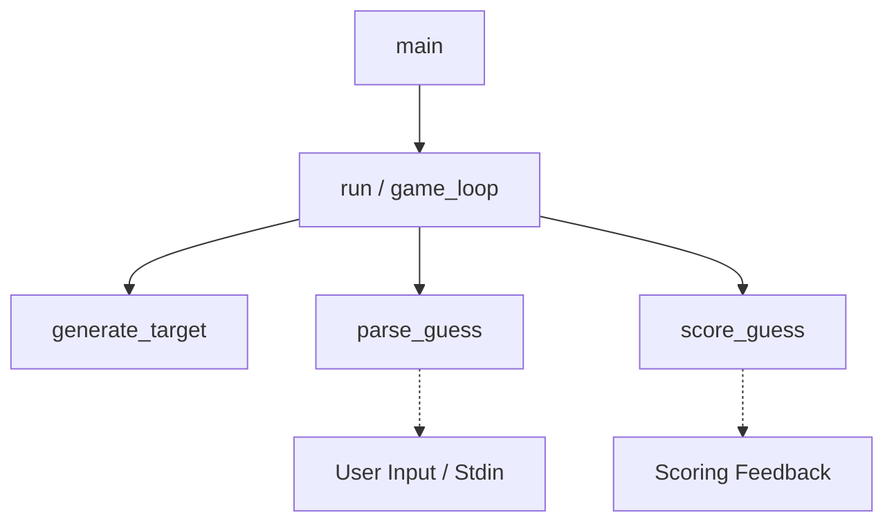

# Mastermind (Bulls and Cows) — Design Document

## 1. Problem and Requirements

The objective of this project is to implement a robust, terminal-based Bulls and Cows (Master Mind) game in Rust for the CS2102 Programming Lab mid-term assignment.

### 1.1 Game Rules
- The computer generates a secret target sequence of length $M$, consisting of integers each in the inclusive range $[1, N]$.
- Repetitions are explicitly permitted in both the secret target sequence and player guesses.
- A **Bull** represents a number in the player's guess that matches the secret target at the exact same position (index).
- A **Cow** represents a number in the player's guess that appears in the target sequence at a *different* position, *after* all Bulls (exact-position matches) have already been accounted for.
- **Duplicate Safety Constraint**: Each target element and each guess element may contribute to at most one match (either one Bull or one Cow, never both, and never multiple Cows).
- The player repeatedly enters guesses until all $M$ positions are Bulls (victory) or the player enters the command `quit`.

### 1.2 System and Interface Constraints
- Guesses must be entered as $M$ whitespace-separated integers (supporting single spaces, multiple spaces, tabs).
- Input errors (incorrect sequence length, non-integer tokens, integers outside $1..=N$) must be handled gracefully without crashing or terminating the game; the game must display an informative error and prompt again without counting the malformed input as an attempt.
- `quit` command must be recognized immediately to exit gracefully.
- End-of-file (EOF) on standard input must be handled cleanly.
- After a game finishes (win or quit), replay options should allow starting a new game or exiting.
- Clear, idiomatic Rust appropriate for educational inspection and verification.

---

## 2. Pre-implementation Design Baseline

*Note: This baseline records design decisions established prior to writing substantive implementation code.*

### Baseline Configuration
- Target sequence length: `const M: usize = 4;`
- Value range: `const N: u32 = 6;` (integers $1..=6$)
- Target and guess representation: fixed-size array `[u32; M]`.
- Parsing buffer: temporary `Vec<u32>` during variable-length token collection, converted into `[u32; M]` after validating count and range.
- Scoring signature: `fn score_guess(target: &[u32], guess: &[u32]) -> (usize, usize)` returning `(bulls, cows)`.
- Random number generation: external crate `rand` (version `0.8`), using thread-local RNG for normal gameplay and seeded PRNG (`StdRng`) for deterministic randomized testing.

---

## 3. Program Architecture

The program adheres to strict separation of concerns, avoiding monolithic logic or hidden global state:



### Responsibility Breakdown
1. **`generate_target() -> [u32; M]`**:
   - Generates $M$ uniform pseudo-random integers in $1..=N$ using `rand::Rng::gen_range`.
   - Returns the target array directly; performs no console I/O.
2. **`parse_guess(input: &str) -> Result<[u32; M], GuessError>`**:
   - Parses a raw string slice into tokens via `split_whitespace()`.
   - Distinguishes the `quit` command.
   - Validates that tokens are valid integers, that the total count equals $M$, and that each value falls within $1..=N$.
   - Safely transforms validated values into `[u32; M]`.
   - Returns a structured error type (`GuessError`) describing the exact failure condition without terminating the process.
3. **`score_guess(target: &[u32], guess: &[u32]) -> (usize, usize)`**:
   - Computes `(bulls, cows)` via a deterministic two-pass algorithm.
   - Pure function: reads inputs via immutable slices, relies on local boolean match markers, performs no I/O, and causes no side effects.
4. **`play_game<R, W>(reader: &mut R, writer: &mut W) -> GameOutcome`**:
   - Orchestrates an individual game session: target generation, guess input loop, round counter, win condition detection, and quit handling.
   - Decoupled from concrete `io::stdin()` / `io::stdout()` using generic traits to allow unit/integration testing with mock input/output streams.
5. **`main()`**:
   - High-level coordinator managing terminal initialization, top-level replay loop, and exit status.

---

## 4. Data Structures

### 4.1 Fixed-Size Arrays `[u32; M]` vs. Vectors `Vec<u32>`

| Dimension | Fixed-Size Array `[u32; M]` | Vector `Vec<u32>` |
| :--- | :--- | :--- |
| **Memory Allocation** | Stack allocated; 0 heap overhead; continuous inline storage. | Heap allocated pointer + capacity + length (24 bytes on 64-bit) plus heap buffer. |
| **Type-Level Guarantee** | Length $M$ is verified at compile time by the Rust type checker. | Length is dynamic; length checks must be maintained manually at runtime. |
| **Semantics** | Expresses fixed domain model: Mastermind target has exactly $M$ pegs. | Expresses variable-length collection that can grow or shrink. |
| **Copy / Clone** | Implements `Copy` for primitive types (e.g., `[u32; 4]` is copied cheaply in registers or stack). | Requires explicit heap allocation (`clone()`). |

#### Rationale for Array Selection:
For the game sequence itself, the length $M$ is known at compile time. Using `[u32; M]` communicates intent, eliminates dynamic memory allocation, and leverages Rust's type system to prevent length mismatches at compile time.

### 4.2 Temporary Vector Usage in Parsing
User input is inherently variable-length: a user may type 1 token, 4 tokens, or 10 tokens. Therefore:
1. Tokens are collected into a temporary `Vec<u32>`.
2. Length validation verifies `vec.len() == M`.
3. Safe conversion into `[u32; M]` is performed via `try_into()` or explicit element assignment.

### 4.3 Future Extension: Dynamic Difficulty (Trade-off Analysis)
If difficulty levels are introduced in the future allowing players to select $M$ and $N$ at runtime:
- Fixed-size arrays cannot have a runtime-specified length (const generics require compile-time constants).
- Redesigning target and guess to use `Vec<u32>` or boxed slices `Box<[u32]>` would then be justified.
- The scoring function `score_guess(target: &[u32], guess: &[u32])` is already designed with slice references `&[u32]`, so it will require **zero signature changes** even if the underlying storage transitions from arrays to vectors.

---

## 5. Mutability and Borrowing

Idiomatic Rust emphasizes immutability by default:
- **Target Sequence**: Once generated by `generate_target()`, the secret code is bound immutably (`let target = ...;`). It must never mutate during the game.
- **Validated Guess**: Each guess is parsed into an immutable binding (`let guess = ...;`) and remains untouched during scoring and display.
- **Scoring Function**: Operates on borrowed slices (`&[u32]`). It borrows both sequences immutably, ensuring neither the target nor the guess is modified or consumed.
- **Justified Mutation**:
  - Input reading requires a mutable `String` buffer (`let mut buffer = String::new();`).
  - Round counter (`let mut attempts: u32 = 0;`) mutates upon each valid guess.
  - Scoring markers inside `score_guess`: local boolean arrays `let mut target_used = [false; M];` and `let mut guess_used = [false; M];` are locally mutated to record matched positions. This mutation is strictly encapsulated within the scoring function.

---

## 6. Functions versus Macros

### Decision: Substantive Logic Encapsulated in Functions
- `score_guess`, `parse_guess`, and `generate_target` are implemented as standard Rust functions.
- **Rationale**:
  - Functions have explicit types, clear signatures, and distinct stack frames.
  - Functions can be unit-tested directly, passed as arguments, and produce clean error messages in compiler diagnostics.
  - In Rust, functions are aggressively inlined by LLVM during release compilation (`--release`), meaning macros offer **no execution performance benefit** over functions.
  - Macros operate on syntax trees and are prone to subtle hygienic, scoping, and readability hazards when used for computational logic.

### Usage of Macros
Standard library macros are used exclusively for their intended syntactic conveniences:
- `println!`, `print!`, `eprintln!`: formatted I/O writing directly to stdout/stderr.
- `write!`, `writeln!`: formatted writing to generic output streams.
- `assert_eq!`, `assert!`: test assertion macros.

---

## 7. Duplicate-Safe Scoring Algorithm

### 7.1 The Duplicate Overcounting Challenge
Consider target `[1, 2, 2, 3]` and guess `[2, 2, 4, 2]`:
- Position 1: Target has 2, Guess has 2. This is a **Bull**.
- Guess has two other 2s (at positions 0 and 3).
- Target has only one unmatched 2 (at position 2).
- If naive counting is used, both guess positions 0 and 3 might match against target position 2, incorrectly producing 2 Cows (totaling 1 Bull and 2 Cows).
- However, since target only has two 2s in total, and one is already a Bull, there is only one 2 remaining to pair as a Cow! Correct result: **1 Bull, 1 Cow**.

### 7.2 Two-Pass Marker Algorithm
To prevent double-counting, we maintain two boolean arrays:
`target_used: [bool; M]` and `guess_used: [bool; M]`, initialized to `false`.

```
Pass 1: Find Bulls (Exact matches)
For i from 0 to M - 1:
    If guess[i] == target[i]:
        bulls += 1
        target_used[i] = true
        guess_used[i] = true

Pass 2: Find Cows (Misplaced matches)
For g from 0 to M - 1:
    If not guess_used[g]:
        For t from 0 to M - 1:
            If not target_used[t] and guess[g] == target[t]:
                cows += 1
                target_used[t] = true
                guess_used[g] = true
                break (advance to next guess element)
```

### 7.3 Proof of Correctness
1. **Exclusivity of Bulls and Cows**: Pass 1 marks both target and guess indices as used. Pass 2 explicitly skips any `guess_used[g] == true` and cannot match with `target_used[t] == true`. Therefore, an element that is a Bull can never be counted as a Cow.
2. **One-to-One Match Invariant**: When a Cow is found between unmatched `guess[g]` and `target[t]`, both `guess_used[g]` and `target_used[t]` are flagged, and the inner loop terminates immediately (`break`). Hence, each target position can satisfy at most one Cow, preventing duplicate overcounting.
3. **Total Bounds Invariant**: Since each match consumes one index in `guess_used` and one index in `target_used`, and markers are never reset:
   $$\text{bulls} + \text{cows} \le M$$

---

## 8. Input Validation and Control Flow

### 8.1 Input Parsing Pipeline
```mermaid
graph LR
    Input[Raw Input String] --> Split[split_whitespace]
    Split --> CheckQuit{Is 'quit'?}
    CheckQuit -- Yes --> QuitErr[Return Quit Signal]
    CheckQuit -- No --> CountCheck{Count == M?}
    CountCheck -- No --> CountErr[Return InvalidLength Error]
    CountCheck -- Yes --> ParseU32{All valid u32?}
    ParseU32 -- No --> TokenErr[Return NonInteger Error]
    ParseU32 -- Yes --> RangeCheck{All in 1..=N?}
    RangeCheck -- No --> RangeErr[Return OutOfRange Error]
    RangeCheck -- Yes --> Success[Return Ok [u32; M]]
```

### 8.2 Error Types
We define an explicit enum `GuessError`:
- `Quit`: player requested to quit.
- `Empty`: player pressed Enter without typing.
- `InvalidLength { expected: usize, actual: usize }`: token count mismatch.
- `InvalidToken(String)`: token could not be parsed as an integer.
- `OutOfRange { val: u32, min: u32, max: u32 }`: integer parsed, but outside $[1, N]$.

Each error variant produces a helpful user-facing explanation in the terminal and allows the user to try again immediately.

---

## 9. Alternatives and Trade-offs

| Decision Area | Chosen Approach | Alternative Considered | Trade-off / Rationale |
| :--- | :--- | :--- | :--- |
| **Game Sequence Storage** | Fixed-size array `[u32; M]` | Heap vector `Vec<u32>` | Array guarantees length $M$ at compile time and zero heap allocation. Vector is more flexible for runtime length, but unnecessary here. |
| **Scoring Algorithm** | Two-pass with boolean marker arrays | Multiset frequency histogram calculation | Two-pass marker algorithm is intuitive, avoids secondary map allocations, and directly maps to physical Mastermind peg rules. Histogram is used as an independent reference test. |
| **Error Handling** | Dedicated `Result<[u32; M], GuessError>` | Panics / `unwrap()` or exit codes | Idiomatic Rust handles expected user errors gracefully without panics or process termination. |
| **Scoring Function Parameter** | Slices `&[u32]` | Fixed array references `&[u32; M]` | Slices decouple scoring logic from fixed array constraints, making it reusable, easier to test, and adaptable to future vector inputs. |
| **RNG Strategy** | `rand::thread_rng()` in game, `rand::rngs::StdRng` in tests | Hand-rolled linear congruential generator (LCG) | `rand` is the standard, well-audited Rust ecosystem solution; `StdRng` allows deterministic seeding for reproducible testing. |

---

## 10. Testing Design

Testing is organized into three distinct tiers:
1. **Deterministic Unit Tests**:
   - Comprehensive test cases covering all edge scenarios for `score_guess`:
     - All Bulls (`[1, 2, 3, 4]` vs `[1, 2, 3, 4]` $\to (4, 0)$)
     - All Cows (`[1, 2, 3, 4]` vs `[4, 3, 2, 1]` $\to (0, 4)$)
     - Mixed (`[1, 2, 3, 4]` vs `[1, 3, 2, 5]` $\to (1, 2)$)
     - No match (`[1, 2, 3, 4]` vs `[5, 6, 5, 6]` $\to (0, 0)$)
     - Duplicate target matching single guess (`[1, 1, 2, 2]` vs `[1, 3, 4, 5]` $\to (1, 0)$)
     - Single target matching duplicate guess (`[1, 2, 3, 4]` vs `[1, 1, 1, 1]` $\to (1, 0)$)
     - Misplaced duplicates (`[1, 2, 1, 2]` vs `[2, 1, 2, 1]` $\to (0, 4)$)
   - Exhaustive parsing unit tests for `parse_guess` with various delimiters, invalid tokens, short/long inputs, out-of-range values, and the `quit` command.
2. **Randomized Differential Testing**:
   - A reference scoring algorithm based on multiset frequency counting is implemented in test modules:
     - Exact matches are counted for Bulls.
     - For remaining unmatched elements, frequency counts $\min(\text{count}_\text{target}(x), \text{count}_\text{guess}(x))$ determine total possible matches minus Bulls.
   - Using a fixed seed (`42`) with `rand::rngs::StdRng`, 10,000 random target/guess pairs are evaluated against both the two-pass algorithm and the reference algorithm.
   - Property invariants verified on all cases:
     - $\text{bulls} \le M$
     - $\text{cows} \le M$
     - $\text{bulls} + \text{cows} \le M$
     - Self comparison: $\text{score}(A, A) = (M, 0)$
     - Multiset permutation comparison: $\text{score}(A, \text{perm}(A)).\text{bulls} + \text{cows} = M$.
3. **Manual / Stream Integration Tests**:
   - Interactive game loop tested using simulated stdin input streams.
   - Verifies prompt responses, attempt tracking, win celebrations, error recovery, and replay logic.

---

## 11. Limitations and Future Extensions
- **Fixed Compile-Time $M$ and $N$**: Currently requires re-compilation to alter length or peg range. Future extension could support runtime difficulty settings (Easy: $M=4, N=6$; Hard: $M=6, N=8$) by adapting representations to `Vec<u32>`.
- **Fixed Number of Attempts**: The game ends after a fixed number of attempts (default 10). Future extension could support dynamic attempt limits based on game difficulty or user preferences with an attempt-based score multiplier.
- **Terminal UI**: Standard plain-text terminal output. Could optionally support ANSI terminal colors in future versions.

---

## 12. Implementation Deviations

No fundamental architectural deviations occurred from the pre-implementation baseline:
- Fixed-size arrays `[u32; M]` were strictly maintained for targets and validated guesses.
- Temporary `Vec<u32>` was used exclusively during token parsing before conversion into `[u32; M]`.
- Scoring algorithm cleanly utilized stack-allocated boolean markers `[bool; M]` with immutable slice borrowing `&[u32]`.
- Functions encapsulated all substantive logic; macros were restricted to formatting and test assertions.
- The two minor test assertion adjustments during Phase 2, Steps 2–4 (correcting inadvertent exact index placements in unit test inputs) were documented in `docs/DEV_LOG.md` and `docs/TESTING.md`.

