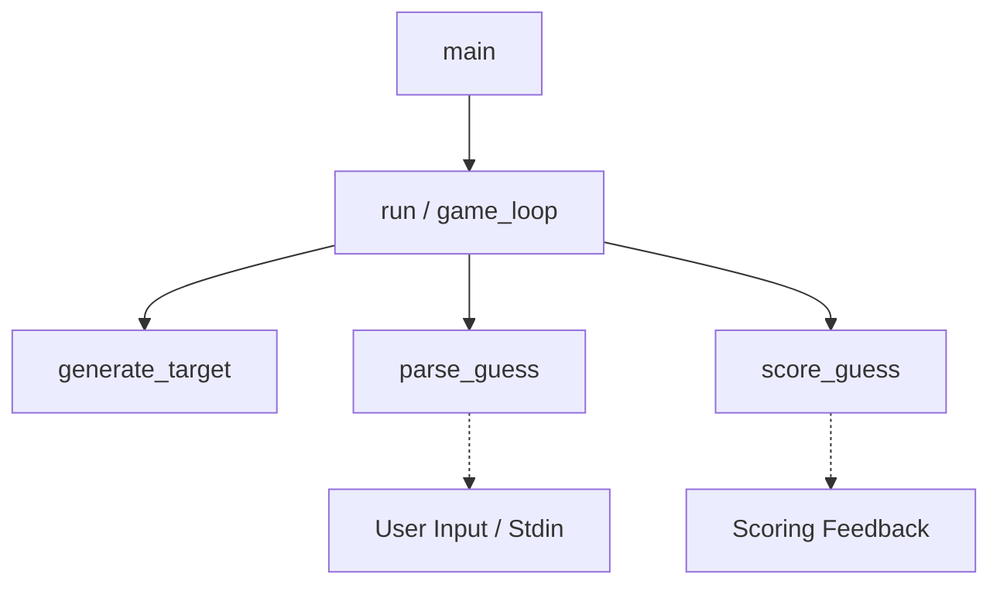
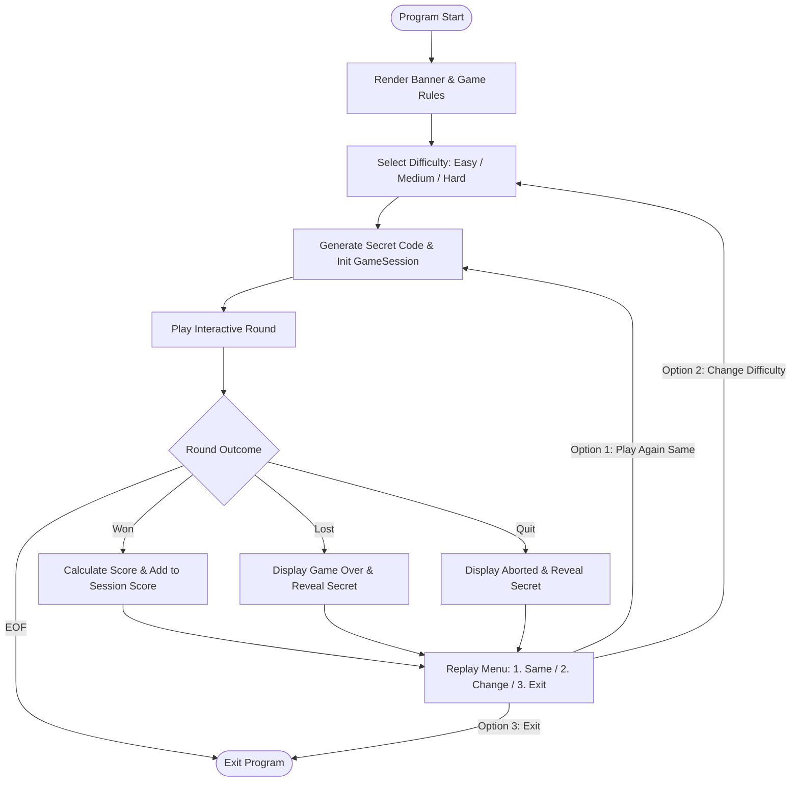
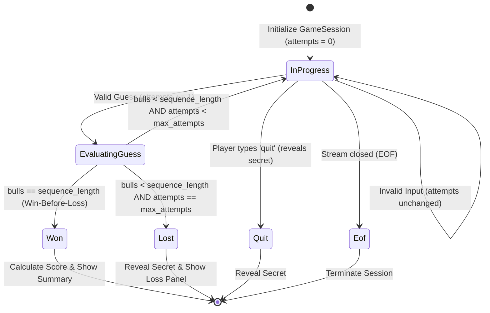
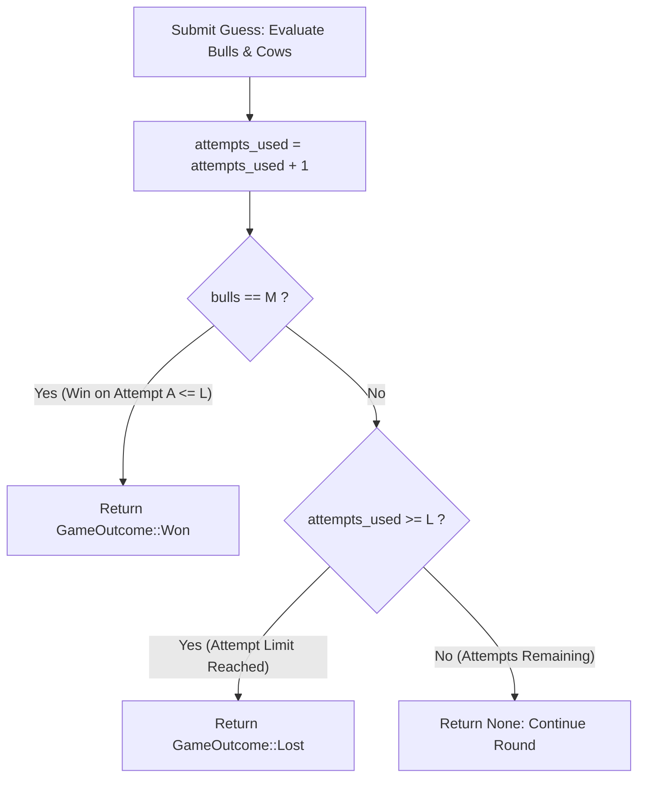
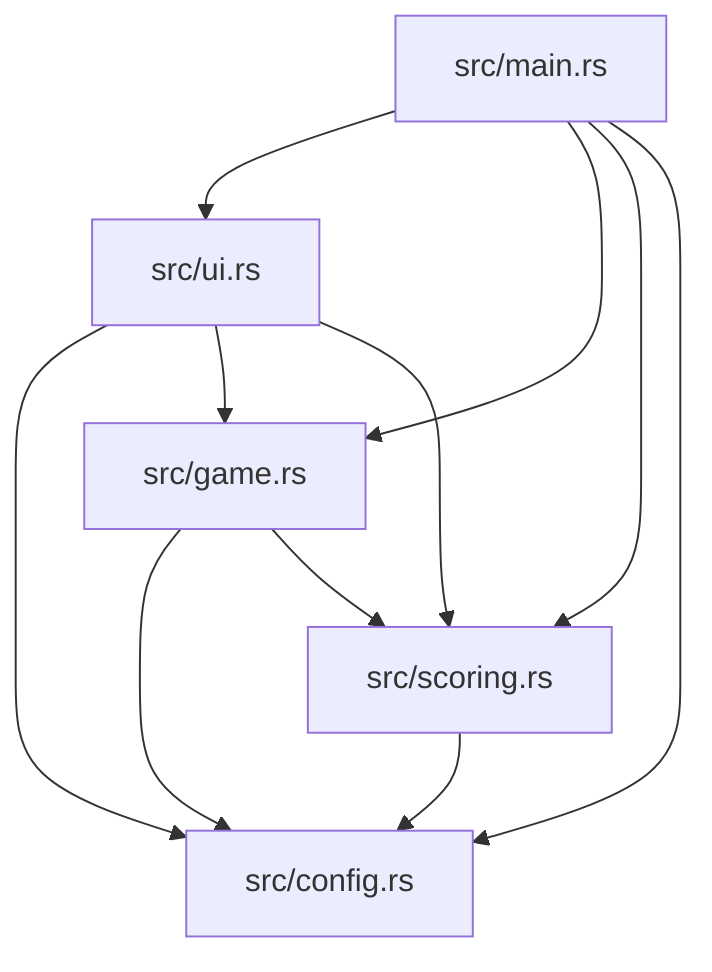

# Mastermind (Bulls and Cows) — Design Document

## 1. Problem and Requirements

The objective of this project is to implement a robust, terminal-based Bulls and Cows (Master Mind) game in Rust for the CS2102 Programming Lab mid-term assignment.

### 1.1 Game Rules
- The computer generates a secret target sequence of length $M$, consisting of integers each in the inclusive range $[1, N]$.
- Repetitions are explicitly permitted in both the secret target sequence and player guesses.
- A **Bull** represents a number in the player's guess that matches the secret target at the exact same position (index).
- A **Cow** represents a number in the player's guess that appears in the target sequence at a *different* position, *after* all Bulls (exact-position matches) have already been accounted for.
- **Duplicate Safety Constraint**: Each target element and each guess element may contribute to at most one match (either one Bull or one Cow, never both, and never multiple Cows).
- The player repeatedly enters guesses until all $M$ positions are Bulls (victory) or the player enters the command `quit`.

### 1.2 System and Interface Constraints
- Guesses must be entered as $M$ whitespace-separated integers (supporting single spaces, multiple spaces, tabs).
- Input errors (incorrect sequence length, non-integer tokens, integers outside $1..=N$) must be handled gracefully without crashing or terminating the game; the game must display an informative error and prompt again without counting the malformed input as an attempt.
- `quit` command must be recognized immediately to exit gracefully.
- End-of-file (EOF) on standard input must be handled cleanly.
- After a game finishes (win or quit), replay options should allow starting a new game or exiting.
- Clear, idiomatic Rust appropriate for inspection and verification.

---

## 2. Pre-implementation Design Baseline

*Note: This baseline records design decisions established prior to writing substantive implementation code.*

### Baseline Configuration
- Target sequence length: `const M: usize = 4;`
- Value range: `const N: u32 = 6;` (integers $1..=6$)
- Target and guess representation: fixed-size array `[u32; M]`.
- Parsing buffer: temporary `Vec<u32>` during variable-length token collection, converted into `[u32; M]` after validating count and range.
- Scoring signature: `fn score_guess(target: &[u32], guess: &[u32]) -> (usize, usize)` returning `(bulls, cows)`.
- Random number generation: external crate `rand` (version `0.8`), using thread-local RNG for normal gameplay and seeded PRNG (`StdRng`) for deterministic randomized testing.

---

## 3. Program Architecture

The program adheres to strict separation of concerns, avoiding monolithic logic or hidden global state:



### Responsibility Breakdown
1. **`generate_target() -> [u32; M]`**:
   - Generates $M$ uniform pseudo-random integers in $1..=N$ using `rand::Rng::gen_range`.
   - Returns the target array directly; performs no console I/O.
2. **`parse_guess(input: &str) -> Result<[u32; M], GuessError>`**:
   - Parses a raw string slice into tokens via `split_whitespace()`.
   - Distinguishes the `quit` command.
   - Validates that tokens are valid integers, that the total count equals $M$, and that each value falls within $1..=N$.
   - Safely transforms validated values into `[u32; M]`.
   - Returns a structured error type (`GuessError`) describing the exact failure condition without terminating the process.
3. **`score_guess(target: &[u32], guess: &[u32]) -> (usize, usize)`**:
   - Computes `(bulls, cows)` via a deterministic two-pass algorithm.
   - Pure function: reads inputs via immutable slices, relies on local boolean match markers, performs no I/O, and causes no side effects.
4. **`play_game<R, W>(reader: &mut R, writer: &mut W) -> GameOutcome`**:
   - Orchestrates an individual game session: target generation, guess input loop, round counter, win condition detection, and quit handling.
   - Decoupled from concrete `io::stdin()` / `io::stdout()` using generic traits to allow unit/integration testing with mock input/output streams.
5. **`main()`**:
   - High-level coordinator managing terminal initialization, top-level replay loop, and exit status.

---

## 4. Data Structures

### 4.1 Fixed-Size Arrays `[u32; M]` vs. Vectors `Vec<u32>`

| Dimension | Fixed-Size Array `[u32; M]` | Vector `Vec<u32>` |
| :--- | :--- | :--- |
| **Memory Allocation** | Stack allocated; 0 heap overhead; continuous inline storage. | Heap allocated pointer + capacity + length (24 bytes on 64-bit) plus heap buffer. |
| **Type-Level Guarantee** | Length $M$ is verified at compile time by the Rust type checker. | Length is dynamic; length checks must be maintained manually at runtime. |
| **Semantics** | Expresses fixed domain model: Mastermind target has exactly $M$ pegs. | Expresses variable-length collection that can grow or shrink. |
| **Copy / Clone** | Implements `Copy` for primitive types (e.g., `[u32; 4]` is copied cheaply in registers or stack). | Requires explicit heap allocation (`clone()`). |

#### Rationale for Array Selection:
For the game sequence itself, the length $M$ is known at compile time. Using `[u32; M]` communicates intent, eliminates dynamic memory allocation, and leverages Rust's type system to prevent length mismatches at compile time.

### 4.2 Temporary Vector Usage in Parsing
User input is inherently variable-length: a user may type 1 token, 4 tokens, or 10 tokens. Therefore:
1. Tokens are collected into a temporary `Vec<u32>`.
2. Length validation verifies `vec.len() == M`.
3. Safe conversion into `[u32; M]` is performed via `try_into()` or explicit element assignment.

### 4.3 Future Extension: Dynamic Difficulty (Trade-off Analysis)
If difficulty levels are introduced in the future allowing players to select $M$ and $N$ at runtime:
- Fixed-size arrays cannot have a runtime-specified length (const generics require compile-time constants).
- Redesigning target and guess to use `Vec<u32>` or boxed slices `Box<[u32]>` would then be justified.
- The scoring function `score_guess(target: &[u32], guess: &[u32])` is already designed with slice references `&[u32]`, so it will require **zero signature changes** even if the underlying storage transitions from arrays to vectors.

---

## 5. Mutability and Borrowing

Idiomatic Rust emphasizes immutability by default:
- **Target Sequence**: Once generated by `generate_target()`, the secret code is bound immutably (`let target = ...;`). It must never mutate during the game.
- **Validated Guess**: Each guess is parsed into an immutable binding (`let guess = ...;`) and remains untouched during scoring and display.
- **Scoring Function**: Operates on borrowed slices (`&[u32]`). It borrows both sequences immutably, ensuring neither the target nor the guess is modified or consumed.
- **Justified Mutation**:
  - Input reading requires a mutable `String` buffer (`let mut buffer = String::new();`).
  - Round counter (`let mut attempts: u32 = 0;`) mutates upon each valid guess.
  - Scoring markers inside `score_guess`: local boolean arrays `let mut target_used = [false; M];` and `let mut guess_used = [false; M];` are locally mutated to record matched positions. This mutation is strictly encapsulated within the scoring function.

---

## 6. Functions versus Macros

### Decision: Substantive Logic Encapsulated in Functions
- `score_guess`, `parse_guess`, and `generate_target` are implemented as standard Rust functions.
- **Rationale**:
  - Functions have explicit types, clear signatures, and distinct stack frames.
  - Functions can be unit-tested directly, passed as arguments, and produce clean error messages in compiler diagnostics.
  - In Rust, functions are aggressively inlined by LLVM during release compilation (`--release`), meaning macros offer **no execution performance benefit** over functions.
  - Macros operate on syntax trees and are prone to subtle hygienic, scoping, and readability hazards when used for computational logic.

### Usage of Macros
Standard library macros are used exclusively for their intended syntactic conveniences:
- `println!`, `print!`, `eprintln!`: formatted I/O writing directly to stdout/stderr.
- `write!`, `writeln!`: formatted writing to generic output streams.
- `assert_eq!`, `assert!`: test assertion macros.

---

## 7. Duplicate-Safe Scoring Algorithm

### 7.1 The Duplicate Overcounting Challenge
Consider target `[1, 2, 2, 3]` and guess `[2, 2, 4, 2]`:
- Position 1: Target has 2, Guess has 2. This is a **Bull**.
- Guess has two other 2s (at positions 0 and 3).
- Target has only one unmatched 2 (at position 2).
- If naive counting is used, both guess positions 0 and 3 might match against target position 2, incorrectly producing 2 Cows (totaling 1 Bull and 2 Cows).
- However, since target only has two 2s in total, and one is already a Bull, there is only one 2 remaining to pair as a Cow! Correct result: **1 Bull, 1 Cow**.

### 7.2 Two-Pass Marker Algorithm
To prevent double-counting, we maintain two boolean arrays:
`target_used: [bool; M]` and `guess_used: [bool; M]`, initialized to `false`.

```
Pass 1: Find Bulls (Exact matches)
For i from 0 to M - 1:
    If guess[i] == target[i]:
        bulls += 1
        target_used[i] = true
        guess_used[i] = true

Pass 2: Find Cows (Misplaced matches)
For g from 0 to M - 1:
    If not guess_used[g]:
        For t from 0 to M - 1:
            If not target_used[t] and guess[g] == target[t]:
                cows += 1
                target_used[t] = true
                guess_used[g] = true
                break (advance to next guess element)
```

### 7.3 Proof of Correctness
1. **Exclusivity of Bulls and Cows**: Pass 1 marks both target and guess indices as used. Pass 2 explicitly skips any `guess_used[g] == true` and cannot match with `target_used[t] == true`. Therefore, an element that is a Bull can never be counted as a Cow.
2. **One-to-One Match Invariant**: When a Cow is found between unmatched `guess[g]` and `target[t]`, both `guess_used[g]` and `target_used[t]` are flagged, and the inner loop terminates immediately (`break`). Hence, each target position can satisfy at most one Cow, preventing duplicate overcounting.
3. **Total Bounds Invariant**: Since each match consumes one index in `guess_used` and one index in `target_used`, and markers are never reset:
   $$\text{bulls} + \text{cows} \le M$$

---

## 8. Input Validation and Control Flow

### 8.1 Input Parsing Pipeline
```mermaid
graph LR
    Input[Raw Input String] --> Split[split_whitespace]
    Split --> CheckQuit{Is 'quit'?}
    CheckQuit -- Yes --> QuitErr[Return Quit Signal]
    CheckQuit -- No --> CountCheck{Count == M?}
    CountCheck -- No --> CountErr[Return InvalidLength Error]
    CountCheck -- Yes --> ParseU32{All valid u32?}
    ParseU32 -- No --> TokenErr[Return NonInteger Error]
    ParseU32 -- Yes --> RangeCheck{All in 1..=N?}
    RangeCheck -- No --> RangeErr[Return OutOfRange Error]
    RangeCheck -- Yes --> Success[Return Ok [u32; M]]
```

### 8.2 Error Types
We define an explicit enum `GuessError`:
- `Quit`: player requested to quit.
- `Empty`: player pressed Enter without typing.
- `InvalidLength { expected: usize, actual: usize }`: token count mismatch.
- `InvalidToken(String)`: token could not be parsed as an integer.
- `OutOfRange { val: u32, min: u32, max: u32 }`: integer parsed, but outside $[1, N]$.

Each error variant produces a helpful user-facing explanation in the terminal and allows the user to try again immediately.

---

## 9. Alternatives and Trade-offs

| Decision Area | Chosen Approach | Alternative Considered | Trade-off / Rationale |
| :--- | :--- | :--- | :--- |
| **Game Sequence Storage** | Fixed-size array `[u32; M]` | Heap vector `Vec<u32>` | Array guarantees length $M$ at compile time and zero heap allocation. Vector is more flexible for runtime length, but unnecessary here. |
| **Scoring Algorithm** | Two-pass with boolean marker arrays | Multiset frequency histogram calculation | Two-pass marker algorithm is intuitive, avoids secondary map allocations, and directly maps to physical Mastermind peg rules. Histogram is used as an independent reference test. |
| **Error Handling** | Dedicated `Result<[u32; M], GuessError>` | Panics / `unwrap()` or exit codes | Idiomatic Rust handles expected user errors gracefully without panics or process termination. |
| **Scoring Function Parameter** | Slices `&[u32]` | Fixed array references `&[u32; M]` | Slices decouple scoring logic from fixed array constraints, making it reusable, easier to test, and adaptable to future vector inputs. |
| **RNG Strategy** | `rand::thread_rng()` in game, `rand::rngs::StdRng` in tests | Hand-rolled linear congruential generator (LCG) | `rand` is the standard, well-audited Rust ecosystem solution; `StdRng` allows deterministic seeding for reproducible testing. |

---

## 10. Testing Design

Testing is organized into three distinct tiers:
1. **Deterministic Unit Tests**:
   - Comprehensive test cases covering all edge scenarios for `score_guess`:
     - All Bulls (`[1, 2, 3, 4]` vs `[1, 2, 3, 4]` $\to (4, 0)$)
     - All Cows (`[1, 2, 3, 4]` vs `[4, 3, 2, 1]` $\to (0, 4)$)
     - Mixed (`[1, 2, 3, 4]` vs `[1, 3, 2, 5]` $\to (1, 2)$)
     - No match (`[1, 2, 3, 4]` vs `[5, 6, 5, 6]` $\to (0, 0)$)
     - Duplicate target matching single guess (`[1, 1, 2, 2]` vs `[1, 3, 4, 5]` $\to (1, 0)$)
     - Single target matching duplicate guess (`[1, 2, 3, 4]` vs `[1, 1, 1, 1]` $\to (1, 0)$)
     - Misplaced duplicates (`[1, 2, 1, 2]` vs `[2, 1, 2, 1]` $\to (0, 4)$)
   - Exhaustive parsing unit tests for `parse_guess` with various delimiters, invalid tokens, short/long inputs, out-of-range values, and the `quit` command.
2. **Randomized Differential Testing**:
   - A reference scoring algorithm based on multiset frequency counting is implemented in test modules:
     - Exact matches are counted for Bulls.
     - For remaining unmatched elements, frequency counts $\min(\text{count}_\text{target}(x), \text{count}_\text{guess}(x))$ determine total possible matches minus Bulls.
   - Using a fixed seed (`42`) with `rand::rngs::StdRng`, 10,000 random target/guess pairs are evaluated against both the two-pass algorithm and the reference algorithm.
   - Property invariants verified on all cases:
     - $\text{bulls} \le M$
     - $\text{cows} \le M$
     - $\text{bulls} + \text{cows} \le M$
     - Self comparison: $\text{score}(A, A) = (M, 0)$
     - Multiset permutation comparison: $\text{score}(A, \text{perm}(A)).\text{bulls} + \text{cows} = M$.
3. **Manual / Stream Integration Tests**:
   - Interactive game loop tested using simulated stdin input streams.
   - Verifies prompt responses, attempt tracking, win celebrations, error recovery, and replay logic.

---

## 11. Limitations and Future Extensions
- **Fixed Compile-Time $M$ and $N$**: Currently requires re-compilation to alter length or peg range. Future extension could support runtime difficulty settings (Easy: $M=4, N=6$; Hard: $M=6, N=8$) by adapting representations to `Vec<u32>`.
- **Unlimited Guess Attempts**: In the current implementation, players have unlimited guesses until they crack the code or enter `quit`. A future extension could introduce an optional maximum attempt cutoff (e.g., 10 attempts) as a difficulty modifier or competitive challenge mode.
- **Terminal UI**: Standard plain-text terminal output. Could optionally support ANSI terminal colors in future versions.


---

## 12. Implementation Deviations (Initial Baseline)

No fundamental architectural deviations occurred from the pre-implementation baseline during the initial phase:
- Fixed-size arrays `[u32; M]` were strictly maintained for targets and validated guesses.
- Temporary `Vec<u32>` was used exclusively during token parsing before conversion into `[u32; M]`.
- Scoring algorithm cleanly utilized stack-allocated boolean markers `[bool; M]` with immutable slice borrowing `&[u32]`.
- Functions encapsulated all substantive logic; macros were restricted to formatting and test assertions.

---

## 13. Post-Implementation Design Update: Difficulty, Scoring & UI Extension

This section documents the architectural evolution of Mastermind from compile-time constants to runtime-configurable difficulty levels, limited attempts, a difficulty-aware scoring formula, and an ANSI terminal interface.

### 13.1 Transition from Fixed-Size Arrays to Vectors
In the original baseline, sequence length $M=4$ was a compile-time constant, making fixed-size arrays `[u32; 4]` appropriate. With runtime difficulty levels (Easy: $M=3$, Medium: $M=4$, Hard: $M=5$), $M$ is no longer known at compile time.
- **Data Structure Selection**: `Vec<u32>` is now used for storing secret target sequences and player guesses.
- **Slice Interface Continuity**: Crucially, `score_guess(target: &[u32], guess: &[u32]) -> (usize, usize)` continues to borrow slices `&[u32]`. This demonstrates the power of Rust's borrowing model: moving the underlying container from arrays `[u32; M]` to `Vec<u32>` required **zero signature changes** to `score_guess`.
- **Dynamic Matching Markers**: Inside `score_guess`, boolean markers are allocated based on the slice length (`vec![false; len]`), preserving duplicate safety across all difficulty tiers.

### 13.2 Centralized Difficulty Configuration
Rather than scattering length, range, and attempt constants across modules, difficulty settings are centralized in `src/config.rs`:

| Level | Sequence Length ($M$) | Peg Range ($N$) | Max Valid Attempts ($L$) | Difficulty Multiplier | Score Range ($A=L \to A=1$) |
| :--- | :---: | :---: | :---: | :---: | :---: |
| **Easy** | 3 | $1..=4$ | 10 | 1.0× | 100 – 190 pts |
| **Medium** | 4 | $1..=6$ | 9 | 2.0× | 200 – 378 pts |
| **Hard** | 5 | $1..=8$ | 8 | 4.0× | 400 – 750 pts |

### 13.3 Attempt Limits & Game State Machine
The game session (`GameSession` in `src/game.rs`) enforces strict attempt accounting:
1. **Invalid Guesses Free**: Non-integer tokens, incorrect token counts, and out-of-range values produce informative diagnostics and **never** consume an attempt.
2. **Valid Guesses Consume 1 Attempt**: Validated guesses increment `attempts_used`.
3. **Win-Before-Loss Edge Case**: On the final allowed attempt ($A = L$), if all pegs match ($bulls = M$), the player **wins**. A loss is declared only if the final attempt fails to solve the code.
4. **Target Revelation**: Losses and voluntary quits reveal the secret code without awarding victory points.

### 13.4 Score and Multiplier Mathematics
The scoring system rewards both difficulty and attempt efficiency:
$$\text{attempt\_multiplier} = 1.0 + \frac{L - A}{L}$$
$$\text{final\_score} = \operatorname{round}(\text{BASE\_POINTS} \times \text{difficulty\_multiplier} \times \text{attempt\_multiplier})$$
where $\text{BASE\_POINTS} = 100$, $A$ is the 1-based attempt number on win ($1 \le A \le L$), and $L$ is max attempts.
- **Strictly Non-Overlapping Score Bands**: By setting difficulty multipliers to 1.0×, 2.0×, and 4.0×, the score bands are strictly stratified:
  $$\text{Easy (100–190)} < \text{Medium (200–378)} < \text{Hard (400–750)}$$
- **Session Accumulation**: Cumulative score is tracked across winning rounds within a session and resets only on program exit.

### 13.5 UI Layer & Plain-Text Fallback
The UI is strictly decoupled in `src/ui.rs`:
- Uses Unicode box-drawing (`╭───╮`, `│`, `╰───╯`) and styled status panels.
- Visual attempt progress bar: `[████████░░] 8 remaining`.
- **Zero-Dependency ANSI Handling**: Implemented directly with standard escape sequences, with reliable `\x1b[0m` resets to prevent color leakage.
- **`NO_COLOR` Compliance**: Inspects `std::env::var_os("NO_COLOR")`. When set (or when running non-interactive automated tests), `ColorMode::Disabled` outputs pure plain text with zero escape characters.

### 13.6 Module Architecture
The monolithic `main.rs` was decomposed into 5 focused modules:
- `src/config.rs`: `Difficulty`, `DifficultyConfig`, constants.
- `src/scoring.rs`: `score_guess`, `calculate_score`, `ScoreBreakdown`.
- `src/game.rs`: `parse_guess`, `generate_target`, `GameSession`, `GameOutcome`, `ReplayChoice`.
- `src/ui.rs`: `ColorMode`, box drawing, progress bars, feedback, summaries.
- `src/main.rs`: High-level session coordination, replay loop, and integration tests.

---

## 14. Comprehensive Refactoring Analysis of `main.rs`

This section details the evolutionary refactoring of the original monolithic `src/main.rs` into the modular architecture, detailing exactly what was preserved, what was changed, what was added, and the rationale for each decision.

### 14.1 Refactoring Matrix

| Subsystem | Original Baseline (`main.rs`) | Current Implementation | Status | Rationale |
| :--- | :--- | :--- | :--- | :--- |
| **Bulls & Cows Matching** | `score_guess(&[u32], &[u32]) -> (usize, usize)` with stack markers `[bool; M]` | `scoring::score_guess(&[u32], &[u32]) -> (usize, usize)` with `vec![false; len]` | **Preserved in core logic**; markers adapted | Slices preserve immutability and zero-copy borrowing; dynamically sized markers support any sequence length $M$. |
| **Sequence Storage** | Stack arrays `[u32; M]` | Heap vectors `Vec<u32>` | **Changed** | $M$ is selected at runtime ($M \in \{3, 4, 5\}$); Rust fixed arrays require compile-time constants. |
| **Guess Parsing** | `parse_guess(input: &str) -> Result<[u32; M], GuessError>` | `game::parse_guess(input: &str, config: &DifficultyConfig) -> Result<Vec<u32>, GuessError>` | **Adapted** | Preserved whitespace splitting, quit detection, and error enum; dynamically parameterized bounds against active config. |
| **Target Generation** | `generate_target() -> [u32; M]` with `generate_target_with_rng` | `game::generate_target(config: &DifficultyConfig) -> Vec<u32>` with generic RNG injection | **Adapted** | Preserved uniform sampling and dependency injection for seeded testing; parameterized length and range. |
| **Reference Scorer** | `reference_score_guess` with multiset frequency counting | `scoring::reference_score_guess` | **Preserved verbatim** | Preserved independent mathematical oracle for randomized differential testing. |
| **Differential Tests** | 10,000 runs on fixed $M=4, N=6$ | 3,000 runs per difficulty ($M=3, 4, 5$, total 9,000 runs) | **Expanded** | Validates correctness across all three runtime difficulty configurations. |
| **Difficulty Settings** | Hardcoded constants `M = 4, N = 6` | `config::Difficulty` and `config::DifficultyConfig` | **Added** | Centralizes configuration to eliminate magic numbers and prevent desynchronization. |
| **Attempt Tracking** | Unlimited guess loop | `game::GameSession` state machine with attempt limit $L$ | **Added** | Enforces limited attempts; invalid guesses are free; win-before-loss evaluation on attempt $A = L$. |
| **Scoring Formula** | None (only guess count printed) | `scoring::calculate_score` ($100 \times \text{diff\_mult} \times \text{att\_mult}$) | **Added** | Transparent, difficulty-stratified points with attempt efficiency rewards. |
| **Session Score** | None | `main::run_with_color` cumulative session tally across wins | **Added** | Persists session score in memory across rounds without requiring file I/O. |
| **Terminal UI** | Plain text `println!` | `ui::ColorMode`, Unicode box drawing, progress bar, `NO_COLOR` fallback | **Added** | Decoupled presentation layer with zero escape leakage; pure plain text fallback. |
| **Game Instructions** | Static text in welcome screen | Integrated into `ui::render_banner` | **Preserved & Enhanced** | Welcomes new players with clear explanation of Bulls, Cows, repetitions, and commands. |
| **Replay Control** | Binary `(y/n)` | 3-way menu (replay same, change difficulty, exit) | **Enhanced** | Allows seamless difficulty switching between rounds. |

### 14.2 What Was Preserved Verbatim or in Principle
1. **The Duplicate-Safe Two-Pass Matching Algorithm**:
   - The original two-pass algorithm (`score_guess`) was retained without altering its algorithmic logic. Pass 1 identifies coordinate-wise exact matches (Bulls) and marks both target and guess indices. Pass 2 scans remaining unmatched guess elements against remaining unmatched target elements (Cows).
   - This ensures that duplicate pegs can never be counted multiple times.
2. **Slice-Based Borrowing (`&[u32]`)**:
   - The interface `score_guess(target: &[u32], guess: &[u32])` was kept identical. By taking borrowed slices rather than owned collections, the function does not take ownership or clone data, demonstrating idiomatic Rust memory efficiency.
3. **Structured Input Error Modeling (`GuessError`)**:
   - The structured error enum (`Quit`, `EmptyInput`, `InvalidLength`, `NonInteger`, `OutOfRange`) was retained, ensuring that input errors remain informative, distinct, and recoverable without panicking.
4. **Whitespace Tolerance & Case-Insensitive Commands**:
   - Tokenization via `split_whitespace()` continues to handle arbitrary mixtures of tabs, single spaces, and multiple spaces. `quit` remains case-insensitive.
5. **RNG Dependency Injection for Seeded Determinism**:
   - The seam `generate_target_with_rng<R: Rng + ?Sized>(rng: &mut R, config: &DifficultyConfig)` was preserved so that tests can inject seeded PRNGs (`rand::rngs::StdRng`) without relying on global randomness.
6. **Independent Reference Oracle & Invariants**:
   - The multiset frequency counting reference scorer was retained to verify that `score_guess` matches the theoretical oracle across thousands of randomized test cases.

### 14.3 What Was Changed and Adapted
1. **Stack Arrays `[u32; M]` to Heap Vectors `Vec<u32>`**:
   - In Rust, array lengths are part of the type signature (`[T; N]`) and must be known at compile time. Because difficulty is chosen at runtime, sequence length $M \in \{3, 4, 5\}$ cannot be a constant generic parameter without complex compile-time monomorphization. `Vec<u32>` was adopted for internal storage of the target and guesses.
2. **Marker Allocations Inside `score_guess`**:
   - The marker arrays `target_used` and `guess_used` were changed from `[bool; M]` to `vec![false; len]`. Sizing markers dynamically from `target.len()` allows the same function to evaluate length 3, 4, or 5 sequences seamlessly.
3. **Config-Aware Parameterization**:
   - `parse_guess` and `generate_target` now accept a reference to `DifficultyConfig`, allowing bounds and token counts to vary dynamically according to the active game setting.
4. **Expanded Replay Options**:
   - The original binary `y/n` prompt was generalized into a 3-choice menu (`ReplayChoice::PlayAgainSame`, `ReplayChoice::ChangeDifficulty`, `ReplayChoice::Exit`), enabling players to switch difficulty levels without restarting the process.

### 14.4 What Was Added
1. **Authoritative Configuration System (`src/config.rs`)**:
   - `Difficulty` enum and `DifficultyConfig` struct centralize sequence length $M$, range $N$, attempt limit $L$, and difficulty multiplier into one single source of truth.
2. **Attempt-Limit State Machine (`src/game.rs`)**:
   - Encapsulated in `GameSession`. Tracks valid attempts used ($A$), ensures invalid input is free, and enforces the win-before-loss precedence on attempt $A = L$.
3. **Scoring and Multiplier Mathematics (`src/scoring.rs`)**:
   - Implemented `calculate_score` with `BASE_POINTS = 100`, attempt efficiency bonus $\left(1.0 + \frac{L-A}{L}\right)$, and difficulty scaling (1.0×, 2.0×, 4.0×).
4. **Decoupled Terminal Presentation (`src/ui.rs`)**:
   - Created a dedicated presentation layer with Unicode box-drawing, color-coded pegs and outcomes, visual progress bar, and comprehensive `NO_COLOR` plain-text fallback.
5. **Session Score Accumulation (`src/main.rs`)**:
   - Added in-memory tracking of cumulative score across winning rounds in the program session.

---

## 15. Game Control Flow, State Machine & Transition Diagrams

### 15.1 Top-Level Application Control Flow

The high-level lifecycle of the program manages difficulty selection, gameplay rounds, session score accumulation, and replay decisions:



---

### 15.2 Round Game State Machine & Transitions

Within a single round, the `GameSession` state machine processes player inputs, validates tokens, updates attempt counts, and evaluates terminal states:



---

### 15.3 Attempt Counter & Win-Before-Loss Precedence Flowchart

A critical requirement is that a correct guess on the final allowed attempt ($A = L$) must be declared a **victory**, not a loss. The precedence logic inside `GameSession::submit_guess` evaluates victory before checking attempt limit exhaustion:



---

### 15.4 Module Dependency & Data Flow Hierarchy

The application enforces a strict unidirectional dependency graph with no circular references:



---

## 16. Complete Architectural Reference Across All Modules

### 16.1 `src/config.rs` (Configuration Subsystem)
- **`Difficulty`**:
  - Variants: `Easy`, `Medium`, `Hard`.
  - Implements: `Debug`, `Clone`, `Copy`, `PartialEq`, `Eq`, `Display`.
  - `name(&self) -> &'static str`: Returns human-readable name.
  - `config(&self) -> DifficultyConfig`: Maps difficulty variant to authoritative settings.
  - `all() -> [Difficulty; 3]`: Authoritative slice of all difficulty options.
  - `from_input(input: &str) -> Option<Difficulty>`: Case-insensitive parser supporting `"1"`, `"2"`, `"3"`, `"easy"`, `"medium"`, `"hard"`.
- **`DifficultyConfig`**:
  - `difficulty: Difficulty`: Active difficulty level.
  - `sequence_length: usize`: Sequence length $M \in \{3, 4, 5\}$.
  - `max_value: u32`: Peg range upper bound $N \in \{4, 6, 8\}$ (inclusive range $1..=N$).
  - `max_attempts: usize`: Allowed guess limit $L \in \{10, 9, 8\}$.
  - `multiplier: f64`: Difficulty multiplier $\{1.0, 2.0, 4.0\}$.
- **`BASE_POINTS: u32 = 100`**: Authoritative base points constant.

### 16.2 `src/scoring.rs` (Scoring Subsystem)
- **`score_guess(target: &[u32], guess: &[u32]) -> (usize, usize)`**:
  - Calculates duplicate-safe Bulls and Cows matching using two-pass marker scanning.
  - Precondition: `assert_eq!(target.len(), guess.len())`.
  - Complexity: $O(M^2)$ time, $O(M)$ heap space (stack-proportional for $M \le 5$).
- **`calculate_score(config: &DifficultyConfig, attempts_used: usize) -> ScoreBreakdown`**:
  - Computes transparent points breakdown.
  - Preconditions: asserts $1 \le \text{attempts\_used} \le \text{config.max\_attempts}$.
  - Multiplier: $\text{attempt\_multiplier} = 1.0 + \frac{L - A}{L}$ using 64-bit floating point arithmetic.
  - Points: $\text{final\_score} = \operatorname{round}(100 \times \text{diff\_mult} \times \text{att\_mult}) \text{ as } \text{u32}$.
- **`ScoreBreakdown`**:
  - Struct holding `difficulty`, `attempts_used`, `attempts_remaining`, `base_points`, `difficulty_multiplier`, `attempt_multiplier`, `effective_multiplier`, `final_score`.
- **`reference_score_guess(target: &[u32], guess: &[u32]) -> (usize, usize)`**:
  - Independent reference oracle using multiset element frequency counters.

### 16.3 `src/game.rs` (Game State Machine & Parsing)
- **`GuessError`**:
  - `Quit`, `EmptyInput`, `InvalidLength { expected, actual }`, `NonInteger(String)`, `OutOfRange { value, min, max }`.
  - Implements `std::fmt::Display` and `std::error::Error`.
- **`parse_guess(input: &str, config: &DifficultyConfig) -> Result<Vec<u32>, GuessError>`**:
  - Tokenizes input, verifies token count against $M$, parses positive integers, and checks bounds $1..=N$.
- **`generate_target(config: &DifficultyConfig) -> Vec<u32>`**:
  - Samples $M$ numbers from $1..=N$ using thread RNG.
- **`generate_target_with_rng<R: Rng + ?Sized>(rng: &mut R, config: &DifficultyConfig) -> Vec<u32>`**:
  - Generic RNG seam for deterministic tests.
- **`GameSession`**:
  - Holds `config: DifficultyConfig`, `secret: Vec<u32>`, `attempts_used: usize`.
  - `submit_guess(&mut self, guess: Vec<u32>) -> (GuessEvaluation, Option<GameOutcome>)`.
  - Evaluates win condition first; if not won, evaluates attempt limit.
- **`GameOutcome`**:
  - `Won { attempts: usize, score: ScoreBreakdown }`
  - `Lost { attempts: usize, secret: Vec<u32> }`
  - `Quit { attempts: usize, secret: Vec<u32> }`
  - `Eof`
- **`ReplayChoice`**:
  - `PlayAgainSame`, `ChangeDifficulty`, `Exit`.

### 16.4 `src/ui.rs` (Presentation & ANSI Subsystem)
- **`ColorMode`**:
  - `Enabled` (ANSI styling), `Disabled` (Pure plain text).
  - `auto_detect()`: Checks `std::env::var_os("NO_COLOR")`.
  - Color helpers (`bold`, `dim`, `red`, `green`, `yellow`, `blue`, `magenta`, `cyan`, `difficulty_color`) ensure immediate `\x1b[0m` reset.
- **Rendering Functions**:
  - `render_banner`: Title banner, box drawing, and How to Play instructions.
  - `render_difficulty_menu`: Displays Easy, Medium, Hard with full parameter specifications.
  - `render_status_panel`: Box panel with difficulty, code length, value range, attempts, and session score.
  - `render_progress_bar`: Visual indicator `[████████░░] 8 remaining`.
  - `render_feedback`: Formatted Bulls (green) and Cows (yellow) counts.
  - `render_win_summary`: Complete score breakdown panel.
  - `render_loss_summary`: Game over panel revealing secret target.
  - `render_quit_summary`: Round aborted panel revealing secret target.
  - `render_replay_menu`: Interactive 3-way replay menu.
  - `render_error`: Diagnostic error messages.

### 16.5 `src/main.rs` (Application Coordinator)
- **`select_difficulty<R, W>`**: Interactive menu loop re-prompting on invalid choice without panicking.
- **`play_round<R, W>`**: Single-round loop prompting guesses, handling errors without attempt penalties, and rendering outcomes.
- **`ask_replay<R, W>`**: Post-game decision prompt managing round transitions.
- **`run_with_color<R, W>`**: Top-level coordinator tracking cumulative `session_score`.
- **`main()`**: Production entry point binding to `io::stdin()` and `io::stdout()` with automatic color detection.


